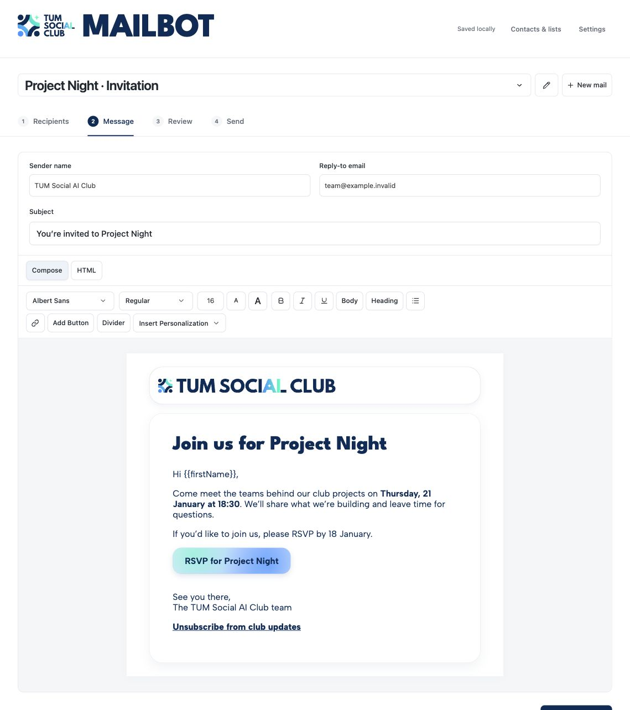

# Club Mailbot

Prepare and send personalized emails from the TUM Social AI Club’s Gmail or Google Workspace account. Build an audience from Notion or CSV, edit the email in the club’s layout, and review what each recipient will see before sending.



[Follow the illustrated member guide](docs/mailbot-guide.md) · [Install locally](#start) · [Check audience rules](#workflow) · [Resume an interrupted campaign](#live-progress-and-resuming)

The guide’s eight screenshots use fictional contacts and example addresses.

## Start

Install Git and Node.js 20 or later, then run these commands from a terminal.

```bash
git clone https://github.com/neinron/club-mailbot.git
cd club-mailbot
cp .env.example .env
npm ci
npm run build:ui
npm start
```

Open [localhost:5177](http://localhost:5177). You can draft and preview a message immediately. A test email needs a connected sender. A live campaign also needs [Notion access](#notion-setup) for eligibility checks and delivery history.

### Connect the club sender

1. Open **Settings** and enter the approved Gmail or Google Workspace address.
2. Use the account owner’s approved credential. The default method uses a Google App Password and requires 2-Step Verification. **Advanced** settings also support an OAuth access token. [Google App Password instructions](https://support.google.com/accounts/answer/185833)
3. Select **Test connection**. To check the actual email, send a separate test from **Send**.

Mailbot keeps verified credentials in server memory for up to eight hours for an App Password or 50 minutes for an OAuth access token. Restarting Mailbot clears them.

## Workflow

| Step | What to do |
| --- | --- |
| **Recipients** | Start a group from Notion, a saved list, or an approved CSV or pasted list. For Notion, check the campaign purpose and filter by fields such as **Touchpoints**. Compare the matched and eligible counts, then select **Use recipients**. |
| **Message** | Set the subject, sender name and optional reply address. Edit the email in **Compose**, insert fields such as `{{firstName}}`, and add buttons. Use **HTML** for custom markup. |
| **Review** | Switch between recipient rows to verify greetings, personal links and missing values. Check the desktop, mobile, dark and images-off previews. |
| **Send** | Send a test to an address you control. Check the received message and its links, then confirm the campaign after reviewing the sender and final recipient count. |

A test uses the selected recipient’s personalization and delivers only to the address entered in **Send a test**. Mailbot strips Cc and Bcc from the test. Assign one owner per live campaign and keep Mailbot running until the delivery log finishes.

### Audience rules

New Notion selections default to newsletter eligibility unless a sending purpose is already configured. Check the purpose before attaching the group. Mailbot rechecks live eligibility against Notion before delivery.

| Purpose | Eligible audience |
| --- | --- |
| **Newsletter** | Contacts whose current **Subscription status** is **Subscribed**. |
| **Recruiting invitation** | Contacts without an active unsubscribe, current membership, or an open or completed application in the current phase. |
| **Application deadline** | Contacts without an active unsubscribe, current membership, or a submitted application in the current phase. This includes people who have started an application. |
| **Finish your application** | Eligible contacts with an incomplete application in the current phase, no completed application, and no current membership. |
| **Browse all contacts** | Available for review only. |

Newsletter eligibility comes from explicit opt-in. CSV imports and manual entries add addresses without granting consent. Check manually assembled lists against the approved source. Refreshing a Notion group or applying its filters can replace local table edits, so review the resulting rows before sending.

## Notion setup

Ask the database owner to grant your integration access to **Newsletter Subscribers**. Copy the settings from [`.env.example`](.env.example) into your local `.env` and set `NOTION_API_KEY`. Mailbot has defaults for the club data source. To use a compatible source, set `NOTION_DATA_SOURCE_ID` and `NOTION_DATABASE_URL`. Set `NOTION_CURRENT_APPLICATION_PHASE` to the active recruitment phase and restart Mailbot after configuration changes.

| Property | Notion type and use |
| --- | --- |
| **Name** | Title for the contact’s full name |
| **Email** | Email with one record per normalized address |
| **First name**, **Last name** | Optional text fields for personalization |
| **Subscription status** | Select with **Subscribed**, **Not subscribed**, **Pending confirmation**, and **Unsubscribed** |
| **Touchpoints** | Multi-select for signup sources, event tags, and application or membership history |

The integration needs to read contacts, create and update pages, and append delivery history to contact pages. Mailbot matches manual entries by normalized email. When it creates a missing contact for delivery logging, it sets the status to **Not subscribed**. Duplicate Notion records for an address block delivery to that address.

### Notion source of truth and opt-outs

The club website handles public signup, double opt-in and unsubscribe. For newsletters, include `{{unsubscribeUrl}}` in the message and check the rendered link in a test email.

Set `PUBLIC_BASE_URL` to the deployed website and explicitly configure `NOTION_DATA_SOURCE_ID` in `.env`. Obtain the existing website signing secret from the club and set `NEWSLETTER_TOKEN_SECRET` to that value. Set `MAILBOT_UNSUBSCRIBE_SECRET` to the same value if you generate links with the CLI. The website records confirmed subscription changes in Notion. For a legacy checkbox source, configure the exact email and opt-in property names for that source.

## Delivery and recovery

Mailbot sends one message per recipient row and records each live attempt in the local journal under `data/deliveries/` and on the linked Notion contact page. If Notion is temporarily unavailable after SMTP accepts a message, Mailbot keeps the send result and retries the history sync separately.

| Status | Meaning and next step |
| --- | --- |
| **Sent** | Gmail’s SMTP server accepted the message. Inbox placement is separate. |
| **Failed** | Mailbot recorded a failed attempt. Check the error before retrying. |
| **Unknown** | Mailbot could not establish the outcome. Check the sender’s Gmail activity and local journal before retrying. |

### Live progress and resuming

Keep the local server running and your computer awake during a campaign. Refreshing the browser leaves the current send running.

After an interruption, use the same computer and local workspace, draft name, subject and sender. Mailbot uses the local journal to skip matching **Sent** entries and block unresolved **Unknown** attempts. A second computer has a separate journal. If Gmail throttles the campaign, check the error and the account’s sending limits before resuming. [Gmail sending limits](https://support.google.com/mail/answer/22839)

## Local data and credentials

| Data | Location |
| --- | --- |
| Web drafts and recipient groups | `data/workspace.json`, with a browser cache |
| Delivery journal | `data/deliveries/` |
| CLI drafts and exports | `drafts/` and `campaigns/` |
| Notion and website integration settings | Local `.env` |
| Verified Gmail credentials | Running server memory |

Keep Mailbot on loopback. Keep local data, credentials, and exports containing real contacts out of Git and screenshots. Draft exports can contain recipient data, so share them only through approved club channels.

## CLI and development

Use the CLI to prepare recipient files, export eligible Notion contacts, validate drafts, preview HTML or manage opt-outs. Send campaigns through the web interface.

```bash
npm run mailbot -- --help
npm run mailbot -- draft check --name "Recruiting launch"
npm run mailbot -- draft preview --name "Recruiting launch" --output /tmp/recruiting-preview.html
```

Web drafts can be exported as JSON and imported with `draft import --input <file.json>`. To bring a CLI draft into the web app, use **Import draft** in the mail title menu. Custom HTML wrappers use `{{content}}`. Existing button macros such as `button{{Choose a slot,interviewLink}}` also work.

| Path | Contents |
| --- | --- |
| `ui/` | React interface and shadcn/ui components |
| `public/` | Editor and audience modules, plus built UI assets |
| `server/` | Local Node server, SMTP delivery and Notion integration |
| `bin/mailbot.js` | CLI entry point |
| `tests/` | Local automated tests |

Run `npm run build:ui` after interface changes. Run `npm test` to check draft handling, recipient preparation, rendering and delivery safeguards with local tests.
