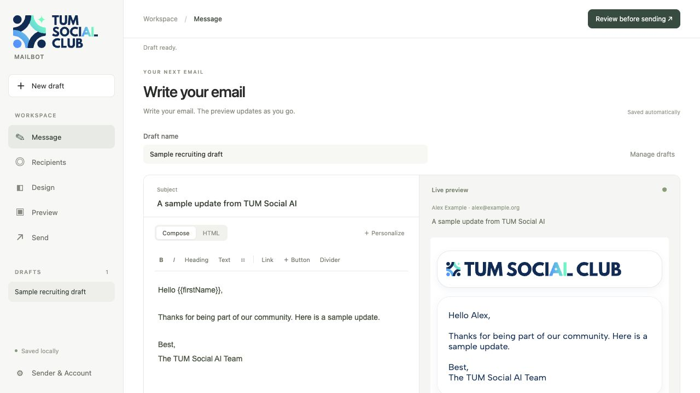
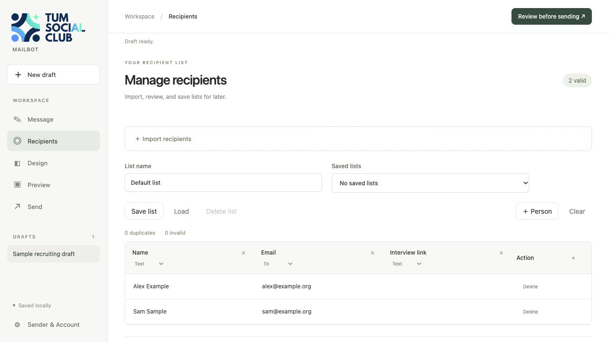
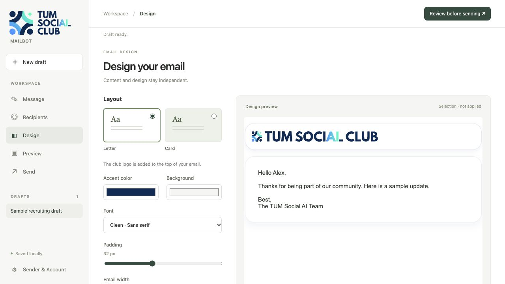
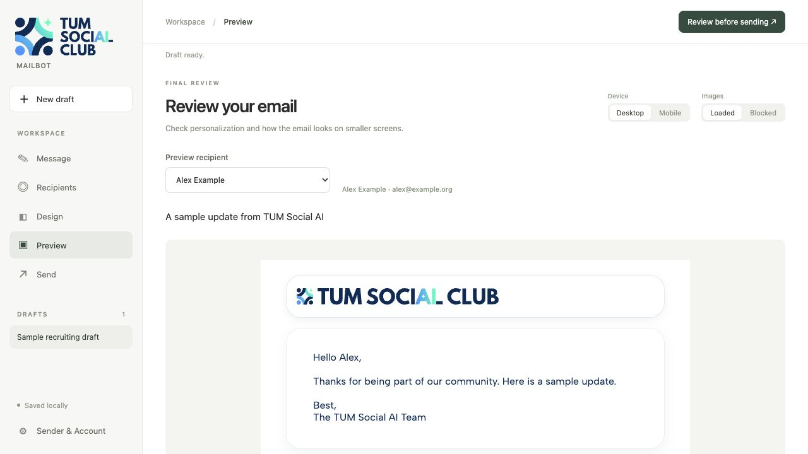
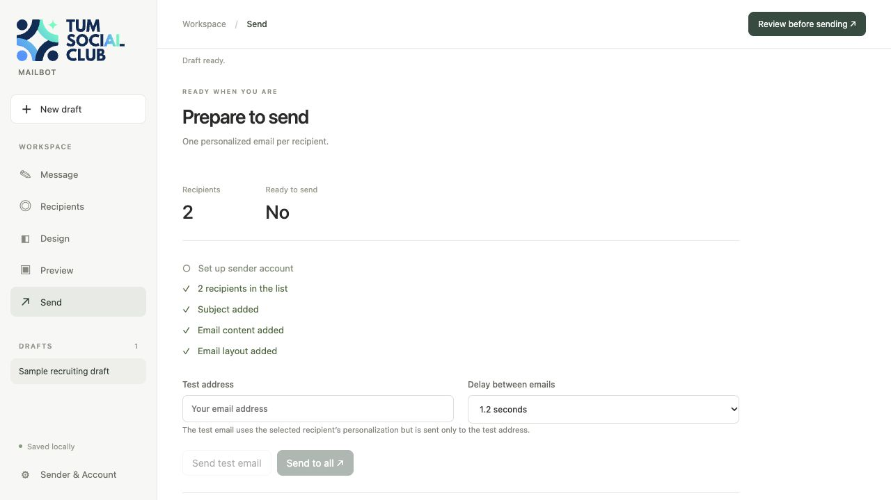
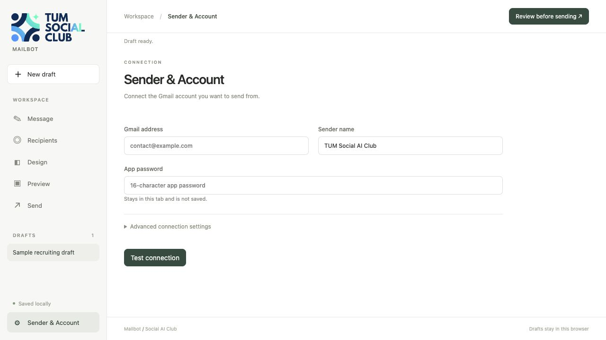

# Mailbot

Mailbot is a local tool for preparing and sending individually personalized club emails through the club's existing Gmail or Google Workspace account. It avoids a separate Mailgun service and its additional provider costs; Google account limits and delivery rules still apply. Mailbot is not a mailing-list or consent-management system.

## Start

```bash
npm start
```

Open [http://localhost:5177](http://localhost:5177). Drafts and recipient lists stay in this browser profile's local storage. Use the same browser and address to return to them. Credentials are not saved.

## Workflow

### 1. Write the message

In **Message**, create or rename a draft, add a subject, and write the email with the visual editor. Use **Personalize** to insert recipient fields such as `{{firstName}}`; use **HTML** for custom markup. Buttons and horizontal dividers can be inserted from the toolbar. The live preview updates as you edit.



### 2. Prepare the recipient list

In **Recipients**, import a CSV or paste rows separated by commas, semicolons, or tabs. The input is data rows without a header. Check the detected rows, duplicates, invalid addresses, column names, and delivery roles. Mark the recipient address as **To**. Save a reusable list only in the local browser profile.

Use only contacts who are eligible to receive that message, such as applicants who opted in to updates. Remove people who have already joined if the campaign excludes them. The tool does not determine consent or membership for you.



### 3. Choose the design

In **Design**, select a letter or card layout and adjust the colors, font, spacing, and width. The preview shows the selection; **Apply to draft** is the step that replaces the current draft's layout. Custom HTML templates must include `{{content}}`.



### 4. Preview and test

Use **Preview** to check each recipient's personalization, desktop/mobile width, and how the email looks when external images are blocked. Then open **Send** and enter your own test address. The test uses one selected row's personalization but is sent only to the test address; its Cc and Bcc fields are removed.



### 5. Send

On **Send**, review the recipient count and checklist. The tool sends one individually addressed message for each data row, with a confirmation before the bulk run. Check the recipient list, test result, subject, links, and audience before confirming. Use small batches and pause if Gmail reports a limit or delivery problem; applicable limits depend on the account and Google's policies.



## Connect the Gmail account

1. Open **Sender & Account** in the sidebar and enter the sender's Gmail or Google Workspace address.
2. Mailbot's default sign-in method is a Google **App Password**. Google requires 2-Step Verification to create one. Generate it in the Google Account's App Passwords settings, then paste it into the app-password field. Do not use the normal Google account password. Google's current instructions and restrictions are [here](https://support.google.com/accounts/answer/185833).
3. Test the connection. The app password stays in the current browser tab's memory and is not written to local storage or sent to GitHub. It is used by the local Mailbot server to authenticate to Gmail SMTP. Re-enter it after closing or refreshing the tab.



Google recommends “Sign in with Google” when an app supports it. Mailbot also exposes an advanced OAuth access-token mode; use the organization's approved method if available. Google Workspace administrators can restrict app passwords, so contact the account owner if the setting is unavailable.

**Shared credential status:** the app password has not yet been added to HeyLogin. Do not assume that another team member can access it there; coordinate access with the account owner. Never put the password in this repository, screenshots, or this guide.

## Why this tool

Mailbot uses Gmail SMTP through an existing club account, so the club does not need a separate paid Mailgun account for this workflow. It stores drafts and recipient lists only in the local browser profile, renders one personalized message per row, and supports a test-only send to an explicit address. It does not replace Google account security, Gmail sending limits, unsubscribe requirements, or the team's recipient/consent checks.

## Data and security

- Drafts, recipient lists, sender metadata, and applied HTML are stored in this browser's `localStorage`; browser profiles and origins have separate storage.
- The app password and OAuth token are not persisted. SMTP command logging masks authentication secrets.
- Do not put real drafts, recipient exports, audit files, or credentials in GitHub. The `campaigns/` and `drafts/` folders are ignored by Git.
- The test-send route requires an explicit valid test address and sends only to it, without Cc or Bcc.
- Google limits sending and can block suspicious or excessive activity. Check the current [Gmail sending limits](https://support.google.com/mail/answer/22839?hl=en) and the relevant Workspace policy before a large send.

## Screenshots

Screenshots in this README use a separate local demo origin and synthetic `example.org` addresses. They contain no campaign draft, real recipient list, or credential.

## Tests

```bash
npm test
```

Tests cover message rendering and test-recipient isolation. They do not connect to Gmail.

## Template compatibility

Existing HTML and button macros remain supported:

```html
<p>Hi {{firstName}},</p>
button{{Choose a slot,interviewLink}}
```

The visual editor shows button macros as editable buttons. Pasted rich text is inserted as plain text; use HTML mode for custom markup. Previews are sandboxed with scripts disabled.
