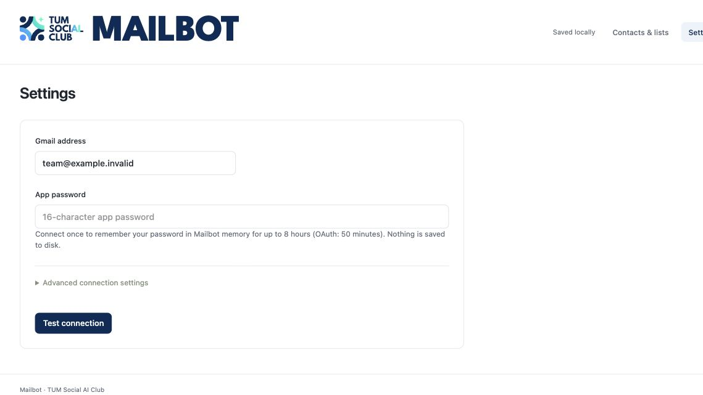
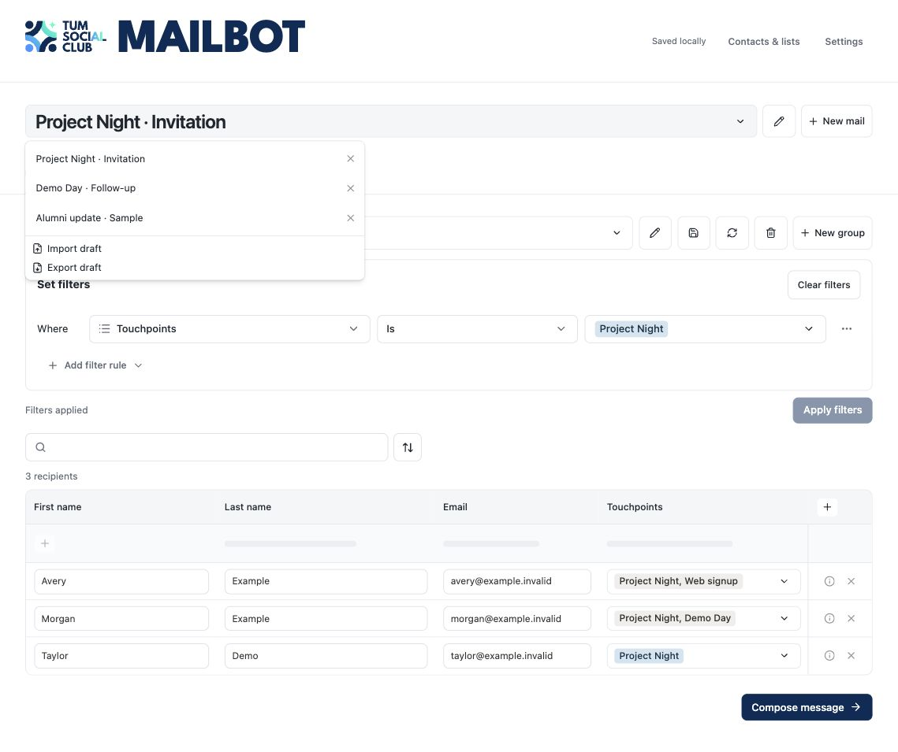
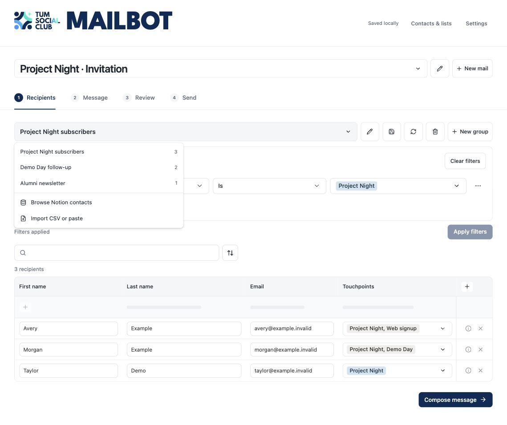
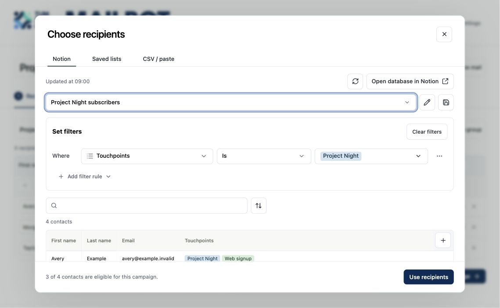
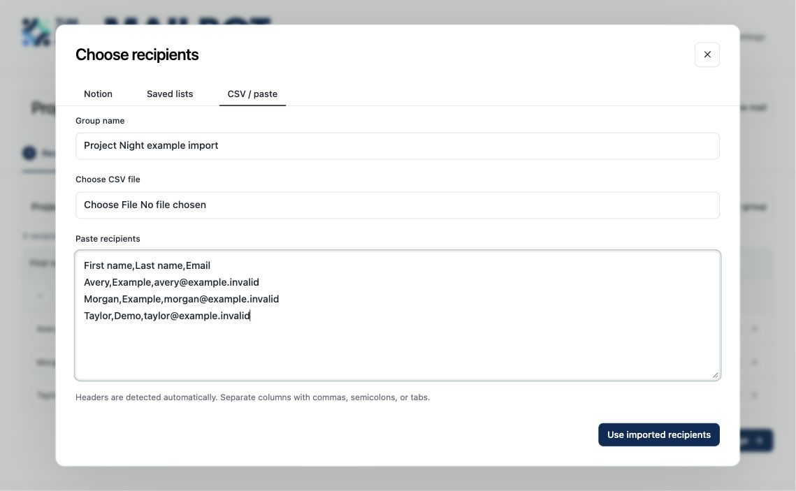
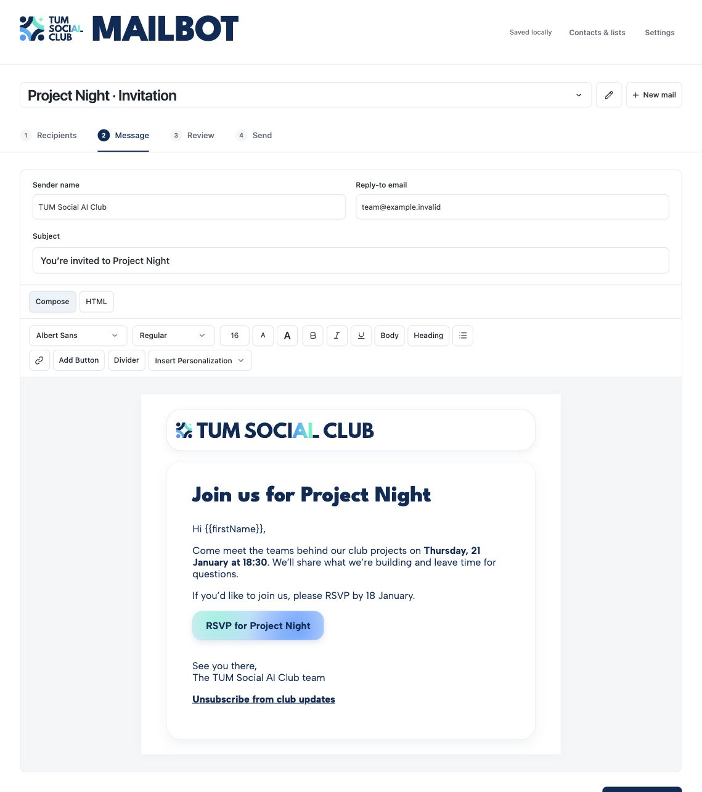
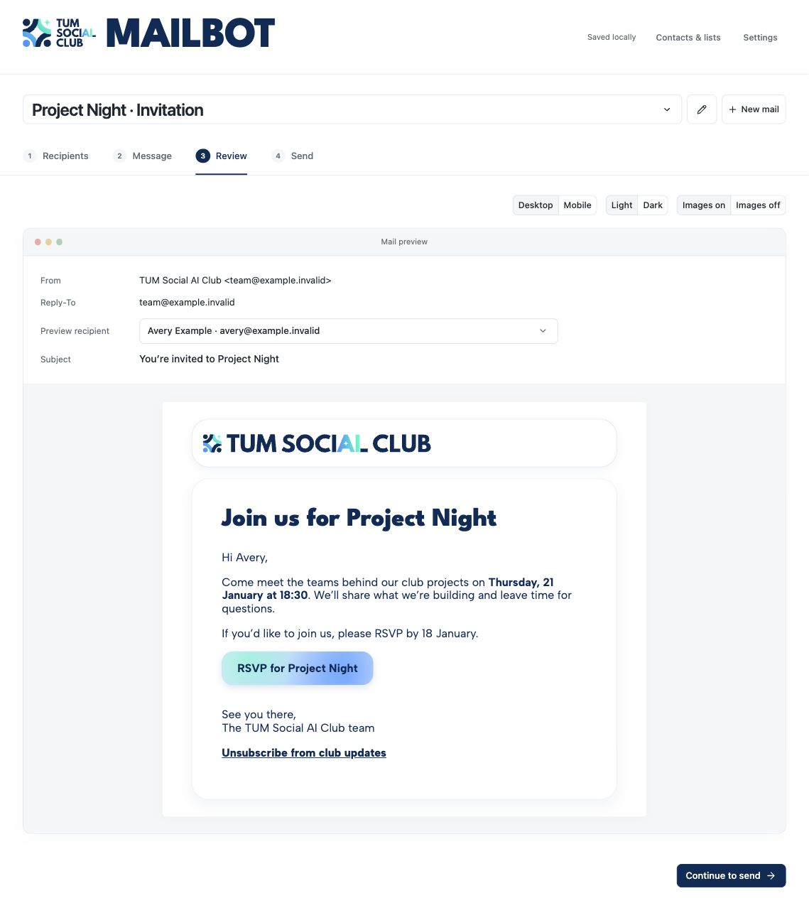
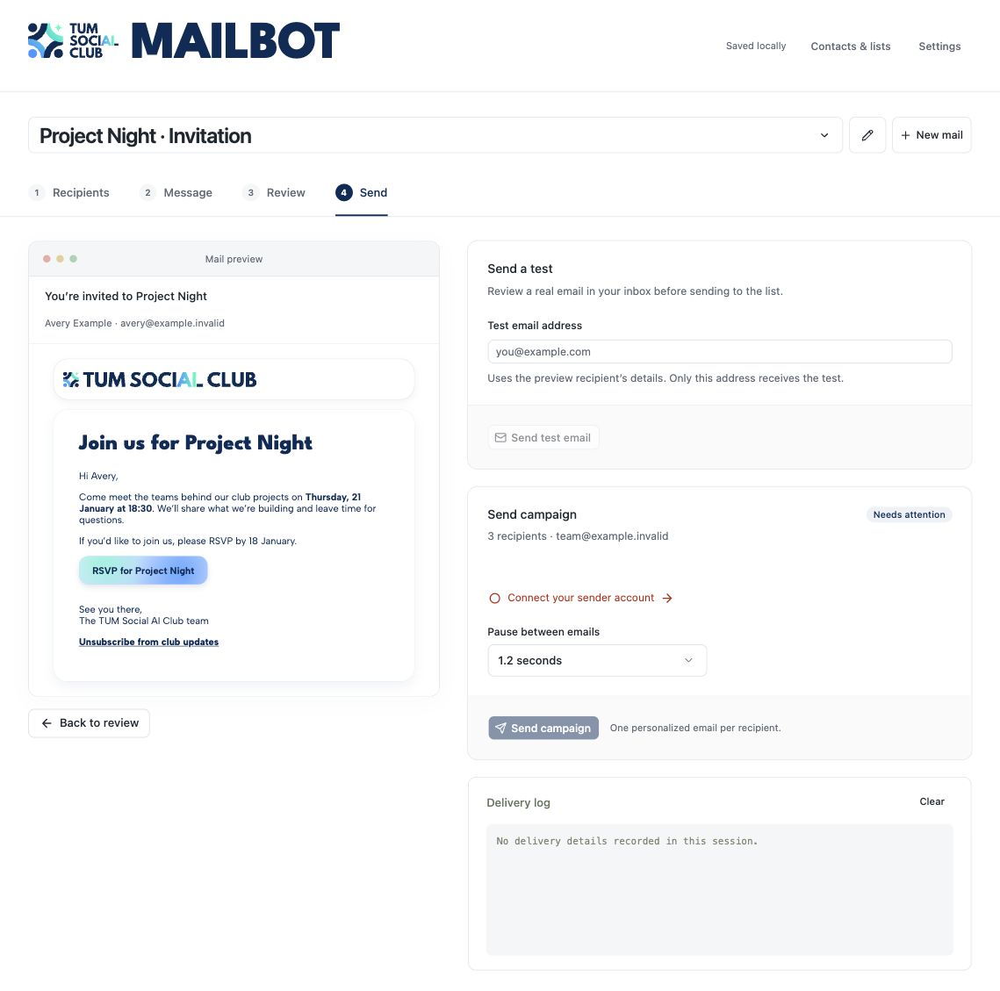

# How to send targeted emails with Mailbot

Use Mailbot when the club needs to send the same announcement to a defined audience with a personalized greeting or link for each person. Work through **Recipients → Message → Review → Send**. Choose one club member to own the send and agree on the audience, sender and timing before anyone starts it.

This guide follows a fictional **Project Night** invitation to three newsletter subscribers. Every person, address and event link in the screenshots is sample data. The example workspace has no mail transport.

## 1. Open Mailbot and connect the club sender

If Mailbot is already installed, run `npm start` from the Mailbot project folder and open [localhost:5177](http://localhost:5177). For a new installation, follow the [repository setup](../README.md#start). The checkout needs Node.js 20 or newer and the club’s approved Notion connection for a live campaign. Ask the database owner to grant the integration access to the club contacts database. Keep the Notion key in your local `.env` file.

1. Open **Settings** in the top-right corner.
2. Enter the approved club Gmail or Google Workspace address. Use the account owner’s approved connection method. The default uses a Google App Password, which requires 2-Step Verification. [Google’s App Password instructions](https://support.google.com/accounts/answer/185833)
3. Select **Test connection**. This checks authentication. You send a separate test message in step 6.
4. Return to the campaign using the **Mailbot** logo. Keep the server running until the campaign finishes.

Mailbot keeps a verified app password in the running server’s memory for up to eight hours. A server restart clears it. Ask the account owner where to obtain the approved credential and keep it out of screenshots, drafts and GitHub.



## 2. Open or create a draft

Select **New mail** and use the pencil beside the title to name it. Use a recognizable name such as **Project Night · Invitation**. To resume a draft, open the title dropdown. Mailbot shows the most recently saved drafts first. Opening another draft preserves that order unless there were pending edits to save.

A draft holds the message and its attached recipient group. A saved group can be reused across drafts. Both are stored on this computer. To hand off a draft, use **Export draft** and share the file through an approved club channel. The export may contain recipient data.



## 3. Choose and check recipients

Open **Recipients**. The group title menu shows saved groups in order of last save. Select a saved group or choose **New group** to build one. The pencil renames the group. The save icon stores the current group for reuse.



### Use Notion contacts

1. Open the group menu and select **Browse Notion contacts**. Use **Open database in Notion** to inspect the source, and the refresh icon to reload the latest contacts.
2. In **Set filters**, select a property, an operator and a value. For the example, choose **Touchpoints**, **Is** and **Project Night**. Use **Add filter rule** to combine conditions with **And** or **Or**, or add a nested group. Choice properties offer their Notion values. Text operators such as **Contains** use a text field.
3. Search just above the table if you need a narrower set. Use the sort icon beside the search box to set sort order or a batch limit. Use **+** in the table header to show or hide extra personalization columns.
4. Compare the matched contacts with the number eligible for this campaign. In the example, four contacts match the tag and three are subscribed. **Use recipients** attaches the eligible three directly. New Notion selections default to newsletter eligibility when no sending purpose is already configured. For a recruiting or application campaign, verify the saved group’s purpose and use the corresponding eligibility rules. [Eligibility rules](../README.md#workflow)
5. Back on **Recipients**, review the attached rows and count. Changes to the inline Notion filters take effect when you select **Apply filters**. A table edited by hand shows **Manually Edited**. Refreshing from Notion or reapplying filters can replace local edits, so check the resulting rows again.



### Import an approved CSV or enter a short list

Choose **Import CSV or paste** from the group menu, name the group, then upload a file or paste the rows. Mailbot detects column headers and accepts commas, semicolons and tabs. Select **Use imported recipients**, then review invalid addresses, duplicates, the **To** column and any extra fields. For a few recipients, choose **Add manually** on an empty manual group. Verify consent and eligibility against the approved source before using a manual list.

Paste these rows into an example draft to practice the import. Use the addresses only for previewing.

```csv
First name,Last name,Email
Avery,Example,avery@example.invalid
Morgan,Example,morgan@example.invalid
Taylor,Demo,taylor@example.invalid
```



## 4. Write and personalize the message

1. Open **Message** and set the **Sender name**, optional **Reply-to email** and **Subject**. The sending address comes from **Settings**. The Reply-to field controls where replies go.
2. Edit the message directly in **Compose**. Select text for bold, italics or underline. **Body** applies paragraph formatting and **Heading** applies the club’s large League Spartan style. Use the font, weight and size controls for other adjustments.
3. Put the cursor where a recipient value belongs and select **Insert Personalization**. For example, insert `{{firstName}}` after “Hi”. Include any custom columns you plan to reference in the attached group, then preview rows where a value might be missing.
4. Choose **Add Button** to enter a label and destination. Select an existing email button to edit it. The example button says **RSVP for Project Night**. Replace the example URL with the approved event or form link for a real campaign. For newsletters, include the club’s configured unsubscribe link. [Unsubscribe setup](../README.md#notion-source-of-truth-and-opt-outs)
5. Use **HTML** if you need to edit the source. Switch back to **Compose** to confirm the result, then select **Review email**.



## 5. Review personalized examples

Use **Preview recipient** to switch between actual rows in the attached group. The example greeting changes from `Hi {{firstName}},` in Compose to **Hi Avery,** in Review. Check more than one row, especially if the message contains a personalized department, deadline or link. Confirm the sender, Reply-To, subject and button destinations. Use **Mobile**, **Dark** and **Images off** to check that the message still reads clearly. Then choose **Continue to send**.



## 6. Send a test, then confirm the campaign

1. In **Send a test**, enter an address you control and choose **Send test email**. Mailbot uses the selected preview recipient’s personalization and sends the test only to the entered address. For a live test, select a preview row whose details you are allowed to see.
2. Check the test in your inbox. Read the subject and greeting, open the button and unsubscribe links as appropriate, and check the sender and reply address.
3. In **Send campaign**, verify the active draft, final recipient count and sender. Resolve any items under **Needs attention**. Recheck time-sensitive audiences against their source, for example by excluding any membership-offer recipients who have since submitted the response form.
4. Select **Send campaign** and read the confirmation dialog before confirming. Mailbot sends one personalized message per recipient row. Coordinate with the other campaign owners before confirming so only one person sends it.

The example has no connected sender, so its send controls are disabled.



## 7. Read the delivery log and handle an interruption

Keep Mailbot running and watch **Delivery log** and the progress counters. **Sent** means the mail server accepted the message. **Failed** means acceptance was not recorded. **Unknown** means the result needs to be checked before a retry. Delivery attempts are also recorded on the linked Notion contact pages. Use responses or other campaign-specific records to determine who still needs a follow-up.

If delivery stops, check the log before restarting. Continue with the same draft name, subject, sender and local workspace so Mailbot can recognize previously accepted messages. Investigate unknown outcomes and check the approved account’s current sending limits if delivery is throttled. [Delivery and recovery details](../README.md#live-progress-and-resuming)

| If you see | What to check |
| --- | --- |
| **Connect your sender account** | Open **Settings**, enter the approved sender credential and run **Test connection**. |
| Fewer eligible contacts than matches | Check the current sending purpose, opt-in status and the source filter. |
| Missing name, link or other value | Check the attached group’s columns and the selected recipient in **Review**. |
| Local edits may be replaced | Check the group name and intended filters before applying or refreshing from Notion. |
| A sent message has a Notion sync warning | Check the delivery log. Mailbot can retry the audit sync separately from the email. |
